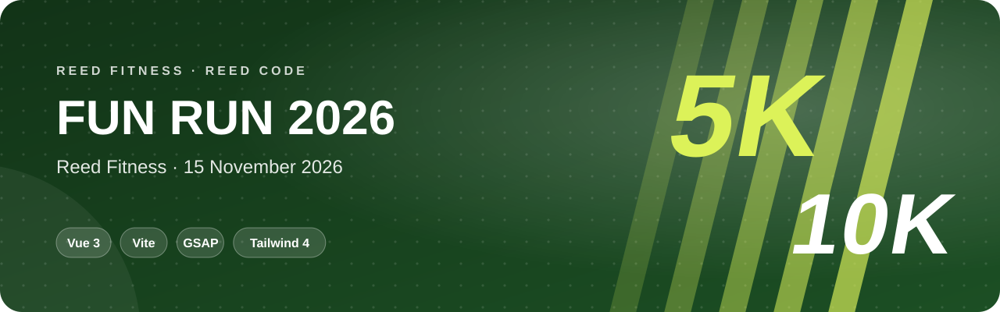
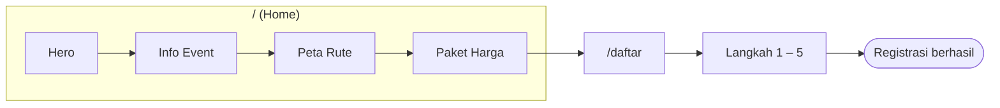

<p align="center">
  
</p>

<p align="center">
  <b>Tegas. Gelap. Cepat.</b> Landing page dan pendaftaran event lari <i>Reed Fitness Fun Run 2026</i> dengan gaya <i>sports brand</i> dan animasi GSAP.
</p>

<p align="center">
  <a href="#sekilas">Sekilas</a> ·
  <a href="#kemampuan">Kemampuan</a> ·
  <a href="#peta-halaman">Peta Halaman</a> ·
  <a href="#mulai-menjalankan">Mulai Menjalankan</a> ·
  <a href="#kustomisasi">Kustomisasi</a>
</p>

<p align="center">
  
  <br>
  
  
</p>

## Sekilas

Website untuk event **Fun Run 5K & 10K** pada **15 November 2026** di Alun-Alun Pusat, terbuka untuk semua kalangan. Desainnya mengusung *Pure Sports Aesthetic*: tipografi **Bebas Neue**, palet hijau gelap `#1C4F24` dengan aksen *electric lime* `#DCF259`, serta animasi masuk dan scroll yang dinamis.

## Kemampuan

<table>
  <tr>
    <td width="50%" valign="top"><b>🎬 Hero Animasi</b><br>Efek masuk dan scroll dengan GSAP.</td>
    <td width="50%" valign="top"><b>📅 Info Event</b><br>Tanggal, lokasi, kategori, dan target peserta.</td>
  </tr>
  <tr>
    <td valign="top"><b>🗺️ Peta Rute</b><br>Visual rute lari untuk peserta.</td>
    <td valign="top"><b>📝 Pendaftaran 5 Langkah</b><br>Validasi per langkah dan tampilan sukses di halaman <code>/daftar</code>.</td>
  </tr>
</table>

| Paket | Member | Non-Member |
|---|---|---|
| **Early Bird** | Rp 125.000 | Rp 150.000 |
| **Normal** | Rp 150.000 | Rp 175.000 |

> Formulir pendaftaran masih **frontend-only**: pengiriman data disimulasikan dan belum terhubung ke backend atau payment gateway.

## Peta Halaman



## Mulai Menjalankan

> Butuh **Node.js 20+** dan npm.

```bash
git clone https://github.com/KyyStacy/funrun-event-landing-vue.git
cd funrun-event-landing-vue
npm install
npm run dev          # http://localhost:5173
```

<details>
<summary><b>Build & deploy</b></summary>

<br>

```bash
npm run build        # hasil di dist/
npm run preview      # cek hasil build
```

`vercel.json` sudah berisi rewrite SPA, jadi project bisa langsung di-deploy ke **Vercel** tanpa 404 di route `/daftar`.

</details>

## Kustomisasi

| Ingin mengubah | Lokasi |
|---|---|
| Warna & font tema | `src/style.css` |
| Tanggal, lokasi, kategori | `src/components/EventInfo.vue` |
| Paket & harga | `src/components/PricingSection.vue` |
| Isian formulir | `src/components/RegistrationForm.vue` |
| Kontak & sosial media | `src/components/FooterSection.vue` |

---

<div align="center">

<h2>Dibuat oleh Kyy Stacy × Reed Code</h2>

<p><i>Web & app developer: dari landing page sampai sistem bisnis custom.</i></p>

<a href="https://www.instagram.com/reedcode.id"></a>
<a href="https://www.tiktok.com/@reedcode.id"></a>
<a href="https://github.com/KyyStacy"></a>

<br><br>

<table>
  <tr>
    <td colspan="4" align="center"><b>Punya ide aplikasi atau butuh website untuk bisnismu?</b><br><sub>Reed Code siap bantu dari desain sampai online.</sub></td>
  </tr>
  <tr>
    <td align="center" width="25%">🌐<br><b>Company Profile</b><br><sub>Website brand & usaha</sub></td>
    <td align="center" width="25%">🛒<br><b>Toko Online</b><br><sub>Katalog & pembayaran online</sub></td>
    <td align="center" width="25%">📊<br><b>Sistem Bisnis</b><br><sub>Kasir, inventaris, booking</sub></td>
    <td align="center" width="25%">📱<br><b>Aplikasi Mobile</b><br><sub>Android & iOS</sub></td>
  </tr>
</table>

<a href="https://wa.me/6285171713355?text=Halo%20Reed%20Code%2C%20saya%20tertarik%20dengan%20jasa%20pembuatan%20website"></a>

<br><br>

<sub>© 2026 Kyy Stacy · Reed Code</sub>

</div>
